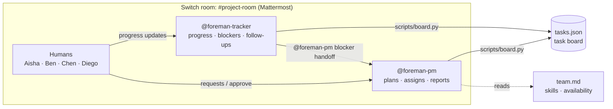

# Foreman

**An AI project manager that lives in your team chat.**
Built for the [Flip the Switch Hackathon](https://www.wemakedevs.org/hackathons/switch), Track 01: Best Business Workflow.

Small teams rarely have a dedicated project manager, so developers lose hours
breaking down work, deciding who owns what, chasing updates and writing status
reports. Foreman puts two AI agents in the team's chat room through
[Switch](https://docs.switchagents.ai). They do that coordination work
alongside the humans, and **a human approves every assignment**.

> Demo video: _<add link>_

## What it does

| You say in the room | What happens |
|---|---|
| `@foreman-pm We need Google OAuth by Friday` | The PM breaks the request into tasks and proposes owners based on skills, load and availability. |
| `@foreman-pm approve` | The proposed tasks become real tasks on the board. |
| `@foreman-tracker Ben here: frontend is blocked on the callback URL` | The Tracker records the blocker and **hands it to the PM**, which proposes an unblock task. |
| `@foreman-pm What is everyone working on, and what is blocking our release?` | The PM produces a status report from the board: progress, blockers, overdue work, each person's tasks, and a release verdict. |

## How Switch is used

Without Switch, these would be two chatbots in separate terminals with no
shared context and no humans involved. Switch provides:

- **A shared room.** Humans, `foreman-pm` and `foreman-tracker` work in one
  Mattermost channel, and everyone sees every message.
- **Agent identities.** Each agent is registered on the Switch server and posts
  as its own team member.
- **Agent-to-agent handoff.** The Tracker escalates blockers by @mentioning the
  PM in the room, and Switch routes the message to the PM's session.
- **Humans in control.** The agents only act when @mentioned. "Who can talk to
  your agent" limits who can instruct them, and new tasks stay `proposed`
  until a human says "approve".
- **Room instructions.** Every agent that joins `project-room` reads
  [`switch/room-instructions.md`](switch/room-instructions.md).
- **Your agent of choice.** The agents run on Codex here, but any provider
  Switch supports works, including Claude Code and OpenCode.

## Architecture



- **`tasks.json`** is the board and the agents' shared memory. Agents change it
  only through `scripts/board.py`, which validates every write and keeps an
  audit trail of who changed what.
- **`team.md`** lists each person's skills, availability and the assignment
  rules.
- **`AGENTS.md`** holds the shared rules every agent follows. Codex reads it
  automatically.
- **`agents/pm.md`** and **`agents/tracker.md`** are the role instructions
  pasted into each agent's settings in Switch.

## Run it yourself (about 15 min)

**You need:** macOS, [Docker](https://www.docker.com/), Python 3, and an AI
coding agent you're signed in to: Codex (`npm i -g @openai/codex`, then
`codex` to sign in), Claude Code, or OpenCode.

1. **Clone the repo and seed the board.**
   ```bash
   git clone <this-repo-url> foreman && cd foreman
   python3 scripts/board.py reset
   python3 scripts/board.py show
   ```
2. **Install Switch.** Install
   [Switch Console](https://docs.switchagents.ai/switch-rooms/getting-started/install-switch-console.md),
   choose **Get started → On this computer**, and pick your agent provider.
3. **Connect Mattermost.** Follow
   [Connect Mattermost](https://docs.switchagents.ai/switch-rooms/deploy/messaging-apps/mattermost.md).
4. **Onboard two agents.** Go to Your Agents → Add agent, following
   [Onboard agents](https://docs.switchagents.ai/switch-rooms/getting-started/onboard-your-agents.md).

   | Field | foreman-pm | foreman-tracker |
   |---|---|---|
   | Name | `foreman-pm` | `foreman-tracker` |
   | Description | AI project manager: plans, assigns, reports | Tracks progress and blockers, follows up |
   | Agent instructions | contents of `agents/pm.md` below the line | contents of `agents/tracker.md` below the line |
   | Run location | This computer | This computer |
   | Directory | the full path to this repo | the full path to this repo |
   | Provider | Codex (or yours) | Codex (or yours) |

   Keep **Bypass permissions** off. Under **Who can talk to your agent**, keep
   **Me and my agents** so the agents can hand work to each other.
5. **Create the room.** Create `project-room`
   ([Create a room](https://docs.switchagents.ai/switch-rooms/getting-started/create-a-room.md)),
   invite both agents, and paste [`switch/room-instructions.md`](switch/room-instructions.md)
   into the room instructions.
6. **Run the demo.** Follow the messages in [`demo/script.md`](demo/script.md).

## Board CLI

```bash
python3 scripts/board.py show        # Kanban view
python3 scripts/board.py report      # status report
python3 scripts/board.py load        # open tasks per person
python3 scripts/board.py validate    # check the board
python3 scripts/board.py reset       # back to the demo seed
python3 scripts/board.py -h          # all commands
```

The tool uses only the Python standard library, so there's nothing to install.

## Repo layout

```
AGENTS.md                  shared rules for all agents (Codex reads this)
agents/pm.md               foreman-pm instructions for Switch
agents/tracker.md          foreman-tracker instructions for Switch
switch/room-instructions.md
team.md                    team skills, availability, assignment rules
seed/tasks.seed.json       demo starting state
tasks.json                 live board (created by board.py)
scripts/board.py           board CLI the agents use
demo/script.md             demo walkthrough
```

## Safety choices

- Agents can only change the board through a validating CLI. They don't edit
  code, run git or make network calls.
- Every task starts as `proposed`, and only a human's "approve" makes it real.
- Each board change records who made it.
- The team in the demo is fictional, and no credentials are stored in the
  repo.

## What's next

- Scheduled daily check-ins by the Tracker.
- Syncing the board to Jira, Linear or GitHub Issues.
- A weekly report agent.
