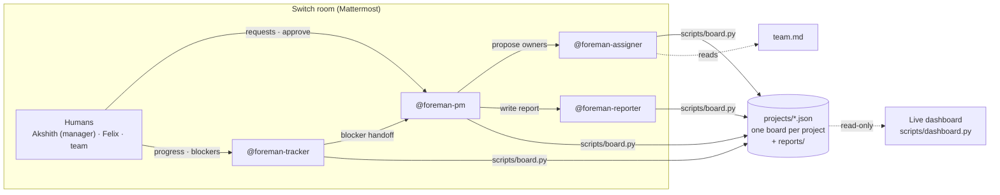

# Foreman

**An AI project manager that lives in your team chat.**
Built for the [Flip the Switch Hackathon](https://www.wemakedevs.org/hackathons/switch), Track 01: Best Business Workflow.

Small teams rarely have a dedicated project manager, so developers lose hours
breaking down work, deciding who owns what, chasing updates and writing status
reports. Foreman puts **four AI agents** in the team's chat room through
[Switch](https://docs.switchagents.ai). They run **all of the team's
projects** from one room: creating projects from a chat message, planning
and assigning work, tracking blockers, balancing workload across projects
and reporting. **A human approves every assignment.** A live dashboard shows
the portfolio and each board changing as the team and agents talk.

> **Demo video:** https://youtu.be/oSAtZTSXuw8 · Build story: [BLOG.md](BLOG.md)

## The team

| Agent | Job |
|---|---|
| `@foreman-pm` | Creates projects, breaks requests into tasks, applies human decisions, resolves blockers, answers status questions for one project or all of them |
| `@foreman-assigner` | Picks an owner for each task from skills, **workload across all projects** and availability, with a reason for each pick |
| `@foreman-tracker` | Records progress and blockers, follows up with owners, escalates blockers to the PM |
| `@foreman-reporter` | Writes daily standups, weekly reports and portfolio reports, saved to `reports/` |

## What it looks like in the room

| Someone says | What happens |
|---|---|
| `@foreman-pm Start a project for the Acme mobile app, v1.0 due 2026-12-01, team Aisha, Felix and Chen` | The PM creates project **ACME**. It appears as a new tab and card on the dashboard. |
| `@foreman-pm INV needs Google OAuth login by Friday` | The PM creates INV tasks, then hands off to **@foreman-assigner**, which proposes owners while checking each person's load across every project. |
| `@foreman-pm approve` | The proposed tasks go on the board. Only a human can do this. |
| `@foreman-tracker Felix here: INV-5 is blocked on the callback URL` | The Tracker marks it blocked and hands it to **@foreman-pm**, which finds the existing config task and asks its owner to start it. |
| `@foreman-pm Priya joined as a frontend engineer, priya@invoicely.example. Add her to ACME.` | The PM registers Priya and adds her to the ACME team. She gets a welcome email. |
| `@foreman-tracker Aisha here: INV-4 is done` | The task moves to Done, and **Akshith (the manager) gets an email**, with Aisha in cc. When the last task of a project is done, the project turns **Completed** and the whole team is emailed. |
| `@foreman-pm email everyone their open INV tasks` | Each owner gets one reminder email listing their open work. |
| `@foreman-pm How are all our projects doing, and is anyone overloaded?` | A portfolio report: health per project, workload across projects and what needs attention first. |
| `@foreman-pm send the portfolio report` | The PM hands off to **@foreman-reporter**, which writes and saves the report. It appears on the dashboard. |

## How Switch is used

Without Switch, these would be four chatbots in separate terminals with no
shared context and no humans involved. Switch provides:

- **A shared room.** Humans and all four agents work in one Mattermost
  channel, and everyone sees every message.
- **Agent identities.** Each agent is registered on the Switch server and posts
  as its own team member.
- **Agent-to-agent handoffs.** The PM hands work to the Assigner and the
  Reporter, and the Tracker escalates to the PM, all by @mention in the room.
  Switch routes each message to the right agent's session.
- **Humans in control.** Agents only act when @mentioned. "Who can talk to
  your agent" limits who can instruct them, and nothing is approved until a
  human says so.
- **Room instructions.** Every agent that joins the room reads
  [`switch/room-instructions.md`](switch/room-instructions.md).
- **Your agent of choice.** The agents run on Codex here, but any provider
  Switch supports works, including Claude Code and OpenCode.

The dashboard is **read-only**. Every change happens in the Switch room.

## Switch setup at a glance

| | What we used |
|---|---|
| **Switch server** | Local Switch server via **Switch Console**, using **Get started → On this computer** |
| **Chat app** | The **Mattermost** bundled with Switch, connected under Home → Messaging apps |
| **Agents connected** | 4 agents, all on **Codex** (`codex-cli`, signed in with ChatGPT) and run on this computer: `foreman-pm`, `foreman-assigner`, `foreman-tracker`, `foreman-reporter`. All 4 have their working directory set to this repo. |
| **Agent instructions** | A two-line pointer per agent ("read `AGENTS.md` and `agents/<role>.md`"), so the behavior lives in the repo |
| **Who can talk to each agent** | **Anyone**, so teammates whose chat accounts aren't linked to Switch can instruct them. Agents still only act when @mentioned. |
| **Channel** | One Switch room (ours is `foreman-demo`) with all 4 agents, the humans, and the room instructions from `switch/room-instructions.md` |
| **Humans in the room** | Akshith (engineering manager) and Felix (frontend engineer) on their own Mattermost accounts. Felix joins from his laptop over a private Tailscale link. Aisha, Chen and Diego are simulated teammates ("Aisha here: …"). |
| **Handoffs** | PM → Assigner (owners), Tracker → PM (blockers), PM → Reporter (reports). All are @mentions in the same room. |

## Teams and email notifications

- **People** live in `people.json`: name, email, role, skills and
  availability, plus who's a manager. Each project has its own **team** and
  **manager**. Only team members can own a project's tasks, and nobody can
  be removed while they still own open work there.
- **Email is triggered by the board tool itself**, not by the model, so it
  can't be forgotten or invented:

  | Event | Who gets emailed |
  |---|---|
  | A human approves a task, or approved work is reassigned | the task owner |
  | A task is marked done | the project manager (owner in cc) |
  | Every task in a project is done, so the project turns **Completed** | the manager and the whole team |
  | Someone joins a project, or a project is created | the new member, or the team |
  | `remind` | each owner, with their open tasks |

- **Safe by default.** Every email is written to `outbox/` as a real `.eml`
  file and shown in the dashboard's **Notifications** panel, but **nothing
  is sent** until you configure SMTP. To see real emails locally without
  sending anything outside your machine, run [Mailpit](https://mailpit.axllent.org):
  ```bash
  docker run -d --name foreman-mailpit -p 127.0.0.1:1025:1025 -p 127.0.0.1:8026:8025 axllent/mailpit
  cp .env.example .env    # points Foreman at 127.0.0.1:1025
  ```
  Then open http://127.0.0.1:8026 to see the inbox.
  The agents run in a sandbox with **no network access**, so they only
  queue emails. The dashboard server, which runs outside the sandbox,
  includes a **mail relay** that delivers queued emails every 3 seconds. Keep
  `scripts/dashboard.py` running, or run `board.py deliver` by hand. For a real mail server,
  set `FOREMAN_SMTP_HOST`, `FOREMAN_SMTP_PORT`, `FOREMAN_SMTP_USER`,
  `FOREMAN_SMTP_PASSWORD` and `FOREMAN_SMTP_TLS=1` in `.env`, which is
  git-ignored.

## Architecture



- **`scripts/board.py`** is the only way to change a board. It validates
  every write, refuses approved tasks without an owner, refuses to start
  unapproved tasks, only lets project members own a project's tasks, and
  records who changed what and when.
- **`projects/<key>.json`** holds one board per project. Task ids carry the
  project key (`INV-4`, `WEB-2`), so an update can't land on the wrong
  project. Together, these files are the agents' shared memory.
- **`AGENTS.md`** holds the shared rules: the roster, who hands off to whom,
  and the hard limits. Codex reads it automatically.
- **`agents/*.md`** are the role files. The instructions in Switch only point
  to them, so changes in the repo apply without touching Switch.
- **The dashboard** (`dashboard/` + `scripts/dashboard.py`) has an **All
  projects** view with a health card per project and workload across
  projects, plus a tab per project with a live Kanban where cards slide
  between columns as agents move them. It also has
  a release-health badge and KPIs, an Agents panel that lights up the agent
  that just acted, team workload, an activity timeline, pop-up
  notifications and the latest report. Plain HTML, CSS and JS, with no
  build step and no dependencies.

## Run it yourself (about 20 min)

**You need:** macOS, [Docker](https://www.docker.com/), Python 3.10+, and an
AI coding agent you're signed in to: Codex, Claude Code or OpenCode.

1. **Clone the repo, seed the board and start the dashboard.**
   ```bash
   git clone https://github.com/akshith-07/foreman-ai-pm.git foreman && cd foreman
   python3 scripts/board.py reset
   python3 scripts/dashboard.py
   ```
   Open http://127.0.0.1:8787.
2. **Install Switch.** Install
   [Switch Console](https://docs.switchagents.ai/switch-rooms/getting-started/install-switch-console.md),
   choose **Get started → On this computer**, and pick your agent provider.
   Mattermost comes bundled.
3. **Onboard four agents.** Go to Your Agents → Add agent, following
   [Onboard agents](https://docs.switchagents.ai/switch-rooms/getting-started/onboard-your-agents.md).

   | Name | Description | Agent instructions |
   |---|---|---|
   | `foreman-pm` | AI project manager: plans, decides, reports status | the quoted block at the top of `agents/pm.md` |
   | `foreman-assigner` | Picks task owners from skills and workload | the quoted block at the top of `agents/assigner.md` |
   | `foreman-tracker` | Tracks progress and blockers, follows up | the quoted block at the top of `agents/tracker.md` |
   | `foreman-reporter` | Writes daily standups and weekly reports | the quoted block at the top of `agents/reporter.md` |

   For all four:
   - **Run location:** This computer.
   - **Directory:** the full path to this repo.
   - **Provider:** your agent.
   - Keep **Bypass permissions** off.
   - Set **Who can talk to your agent** to **Anyone**, so teammates can
     talk to the agents and the agents can hand work to each other. On
     **Me and my agents**, a teammate's message gets "I only take
     instructions from my owner."
4. **Create the room.** Create a room, for example `foreman-demo`
   ([Create a room](https://docs.switchagents.ai/switch-rooms/getting-started/create-a-room.md)),
   invite all four agents, and paste [`switch/room-instructions.md`](switch/room-instructions.md)
   into the room instructions. Then fully quit and reopen Switch Console, so
   every agent starts a fresh session.
5. **Bring in a teammate (optional).** The bundled Mattermost only listens on
   this Mac. To share it privately, install [Tailscale](https://tailscale.com)
   on both laptops, invite your teammate, then run:
   ```bash
   tailscale serve --bg <mattermost-port>    # shown in the Mattermost URL, e.g. 51477
   ```
   Your teammate opens the printed `https://<your-mac>.<tailnet>.ts.net`
   address, creates an account, and joins the room. Use `serve`, never
   `funnel`, which would make it public. Stop sharing with `tailscale serve reset`.
6. **Real emails (optional).** Start Mailpit and `cp .env.example .env`, as
   described under [Teams and email notifications](#teams-and-email-notifications).
   Keep `scripts/dashboard.py` running, because its mail relay sends the
   emails the sandboxed agents queue.
7. **Run the demo.** Follow the flow in the
   [demo video](https://youtu.be/oSAtZTSXuw8).

### Troubleshooting

- **Codex says "code-mode host unavailable" or "exited during handshake."**
  macOS Gatekeeper is blocking `codex-code-mode-host`. Allow it in
  **System Settings → Privacy & Security → Open Anyway**, then fully quit and
  reopen Switch Console. Its running Codex processes keep the old state
  until you do.
- **An agent replies but runs nothing.** Check that the agent's Directory is
  this repo. It can't be changed after the agent is created.
- **An agent refuses a teammate** ("I only take instructions from my owner").
  Set its **Who can talk to your agent** to **Anyone**.
- **Emails show "failed: Operation not permitted."** The agent sandbox has no
  network access, which is intended. Make sure `scripts/dashboard.py` is
  running with a `.env`; its mail relay delivers queued emails within 3
  seconds.
- **Agents still act on old rules.** They're on an old session. Fully quit and
  reopen Switch Console.

## Board CLI

```bash
python3 scripts/board.py projects            # list projects with health
python3 scripts/board.py portfolio           # all projects + workload across them
python3 scripts/board.py new-project --name "Acme Mobile App" --key ACME --release v1.0 --due 2026-12-01 --team aisha,felix,chen --by you
python3 scripts/board.py show -p INV         # one project's Kanban
python3 scripts/board.py report -p INV       # status report with release health
python3 scripts/board.py standup -p INV      # daily standup data
python3 scripts/board.py load                # open tasks per person, all projects
python3 scripts/board.py team -p INV         # a project's team, manager, skills and load
python3 scripts/board.py add-person --handle priya --name Priya --email priya@invoicely.example --role "Frontend engineer" --by you
python3 scripts/board.py add-member -p ACME priya --by you
python3 scripts/board.py remind -p INV --by you   # email owners their open tasks
python3 scripts/board.py emails              # recent notifications and their status
python3 scripts/board.py validate            # check every project
python3 scripts/board.py reset               # back to the demo seed (clears reports)
python3 scripts/board.py -h                  # all commands
```

The demo starts with two projects, **INV** (Invoicely v1.2) and **WEB**
(Website Revamp), which share people. That's why the cross-project
workload view matters.

## Repo layout

```
AGENTS.md                   shared rules and roster (Codex reads this)
agents/pm.md                foreman-pm role
agents/assigner.md          foreman-assigner role
agents/tracker.md           foreman-tracker role
agents/reporter.md          foreman-reporter role
switch/room-instructions.md
team.md                     assignment rules
seed/projects/*.json        demo starting state (INV, WEB)
seed/people.json            demo people (Akshith the manager, Aisha, Felix, Chen, Diego)
projects/                   live boards, one per project (created by board.py)
people.json                 live people registry (created by board.py)
outbox/                     every notification email as .eml + log.jsonl
scripts/notify.py           email: outbox by default, SMTP when configured
.env.example                SMTP settings for a local Mailpit
reports/                    saved standups, weekly and portfolio reports
scripts/board.py            board CLI the agents use
scripts/dashboard.py        dashboard server (serves dashboard/ + /api/state)
dashboard/                  index.html, styles.css, app.js (live read-only UI)
```

## Safety choices

- Agents change state only through a validating CLI. They don't edit code,
  run git or make network calls.
- Every task starts as `proposed`. Only a human's "approve" makes it real,
  and agents are told never to approve.
- Each change records who made it and when, and the dashboard's activity feed
  shows the full trail.
- Agents only @mention each other to hand off work, which prevents loops.
- Emails are triggered by board events in code, never written by the model.
  They're saved locally and only sent when you explicitly configure SMTP.
- The team in the demo is fictional, and no credentials are stored in the
  repo.

## What we learned

- **The model is the easy part.** The real work is in tool boundaries,
  approvals, state and audit trails.
- **Enforce rules in code, not only in prompts.** The prompt says "only
  humans approve", but `board.py` also refuses to start unapproved tasks or
  approve unowned ones.
- **Test the real flow, then fix both the prompt and the tooling.** Our PM
  created a duplicate task, which we fixed with a no-duplicates rule plus a
  `cancel` command.
- **Most agent failures are environmental.** Our biggest bug was macOS
  quarantining a Codex helper binary, not anything the model did.

## What's next

- Scheduled daily check-ins and standups.
- Syncing boards with Jira, Linear or GitHub Issues.
- Automatic rebalancing suggestions when someone is overloaded.
- Learning owner preferences from past assignments.
