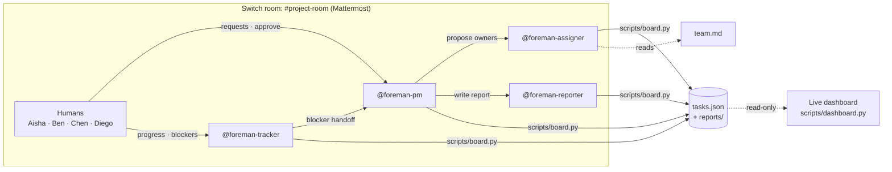

# Foreman

**An AI project manager that lives in your team chat.**
Built for the [Flip the Switch Hackathon](https://www.wemakedevs.org/hackathons/switch), Track 01: Best Business Workflow.

Small teams rarely have a dedicated project manager, so developers lose hours
breaking down work, deciding who owns what, chasing updates and writing status
reports. Foreman puts **four AI agents** in the team's chat room through
[Switch](https://docs.switchagents.ai). They handle that coordination
alongside the humans, and **a human approves every assignment**. A live
dashboard shows the board changing as the team and agents talk.

> Demo video: _<add link>_

## The team

| Agent | Job |
|---|---|
| `@foreman-pm` | Breaks requests into tasks, applies human decisions, resolves blockers, answers "what's blocking the release?" |
| `@foreman-assigner` | Picks an owner for each task from skills, workload and availability, and gives a reason for each pick |
| `@foreman-tracker` | Records progress and blockers, follows up with owners, escalates blockers to the PM |
| `@foreman-reporter` | Writes daily standups and weekly reports, saved to `reports/` |

## What it looks like in the room

| Someone says | What happens |
|---|---|
| `@foreman-pm We need Google OAuth by Friday` | The PM creates tasks, then hands off to **@foreman-assigner**, which proposes an owner for each with a reason. |
| `@foreman-pm approve` | The proposed tasks go on the board. Only a human can do this. |
| `@foreman-tracker Ben here: frontend is blocked on the callback URL` | The Tracker marks it blocked and hands it to **@foreman-pm**, which finds the existing config task and asks its owner to start it. |
| `@foreman-pm What is everyone working on, and what is blocking our release?` | A status report from the board: health verdict, blockers, overdue work and each person's tasks. |
| `@foreman-pm send today's standup` | The PM hands off to **@foreman-reporter**, which writes and saves the standup. It appears on the dashboard. |

## How Switch is used

Without Switch, these would be four chatbots in separate terminals with no
shared context and no humans involved. Switch provides:

- **A shared room.** Humans and all four agents work in one Mattermost
  channel, and everyone sees every message.
- **Agent identities.** Each agent is registered on the Switch server and posts
  as its own team member.
- **Agent-to-agent handoffs.** The PM hands work to the Assigner and the
  Reporter, and the Tracker escalates to the PM, all by @mention in the room.
  Switch routes each message to the right agent's session.
- **Humans in control.** Agents only act when @mentioned. "Who can talk to
  your agent" limits who can instruct them, and nothing is approved until a
  human says so.
- **Room instructions.** Every agent that joins `project-room` reads
  [`switch/room-instructions.md`](switch/room-instructions.md).
- **Your agent of choice.** The agents run on Codex here, but any provider
  Switch supports works, including Claude Code and OpenCode.

The dashboard is **read-only**. Every change happens in the Switch room.

## Architecture



- **`scripts/board.py`** is the only way to change the board. It validates
  every write, refuses approved tasks without an owner, refuses to start
  unapproved tasks, and records who changed what and when.
- **`tasks.json`** is the board and the agents' shared memory.
- **`AGENTS.md`** holds the shared rules: the roster, who hands off to whom,
  and the hard limits. Codex reads it automatically.
- **`agents/*.md`** are the role files. The instructions in Switch only point
  to them, so changes in the repo apply without touching Switch.
- **`scripts/dashboard.py`** serves a live Kanban, health badge, workload
  bars, activity feed and the latest report. It uses only the Python
  standard library.

## Run it yourself (about 20 min)

**You need:** macOS, [Docker](https://www.docker.com/), Python 3.10+, and an
AI coding agent you're signed in to: Codex, Claude Code or OpenCode.

1. **Clone the repo, seed the board and start the dashboard.**
   ```bash
   git clone https://github.com/akshith-07/foreman-ai-pm.git foreman && cd foreman
   python3 scripts/board.py reset
   python3 scripts/dashboard.py
   ```
   Open http://127.0.0.1:8787.
2. **Install Switch.** Install
   [Switch Console](https://docs.switchagents.ai/switch-rooms/getting-started/install-switch-console.md),
   choose **Get started → On this computer**, and pick your agent provider.
   Mattermost comes bundled.
3. **Onboard four agents.** Go to Your Agents → Add agent, following
   [Onboard agents](https://docs.switchagents.ai/switch-rooms/getting-started/onboard-your-agents.md).

   | Name | Description | Agent instructions |
   |---|---|---|
   | `foreman-pm` | AI project manager: plans, decides, reports status | the quoted block at the top of `agents/pm.md` |
   | `foreman-assigner` | Picks task owners from skills and workload | the quoted block at the top of `agents/assigner.md` |
   | `foreman-tracker` | Tracks progress and blockers, follows up | the quoted block at the top of `agents/tracker.md` |
   | `foreman-reporter` | Writes daily standups and weekly reports | the quoted block at the top of `agents/reporter.md` |

   For all four:
   - **Run location:** This computer.
   - **Directory:** the full path to this repo.
   - **Provider:** your agent.
   - Keep **Bypass permissions** off.
   - Keep **Who can talk to your agent** on **Me and my agents**, so the
     agents can hand work to each other.
4. **Create the room.** Create `project-room`
   ([Create a room](https://docs.switchagents.ai/switch-rooms/getting-started/create-a-room.md)),
   invite all four agents, and paste [`switch/room-instructions.md`](switch/room-instructions.md)
   into the room instructions.
5. **Run the demo.** Follow [`demo/script.md`](demo/script.md).

### Troubleshooting

- **Codex says "code-mode host unavailable" or "exited during handshake."**
  macOS Gatekeeper is blocking `codex-code-mode-host`. Allow it in
  **System Settings → Privacy & Security → Open Anyway**, then fully quit and
  reopen Switch Console. Its running Codex processes keep the old state
  until you do.
- **An agent replies but runs nothing.** Check that the agent's Directory is
  this repo. It can't be changed after the agent is created.

## Board CLI

```bash
python3 scripts/board.py show         # Kanban view
python3 scripts/board.py report       # status report with release health
python3 scripts/board.py standup      # daily standup data
python3 scripts/board.py weekly       # weekly report data
python3 scripts/board.py load         # open tasks per person
python3 scripts/board.py validate     # check the board
python3 scripts/board.py reset        # back to the demo seed (clears reports)
python3 scripts/board.py -h           # all commands
```

## Repo layout

```
AGENTS.md                   shared rules and roster (Codex reads this)
agents/pm.md                foreman-pm role
agents/assigner.md          foreman-assigner role
agents/tracker.md           foreman-tracker role
agents/reporter.md          foreman-reporter role
switch/room-instructions.md
team.md                     team skills, availability, assignment rules
seed/tasks.seed.json        demo starting state
tasks.json                  live board
reports/                    saved standups and weekly reports
scripts/board.py            board CLI the agents use
scripts/dashboard.py        live read-only dashboard
demo/script.md              demo walkthrough
```

## Safety choices

- Agents change state only through a validating CLI. They don't edit code,
  run git or make network calls.
- Every task starts as `proposed`. Only a human's "approve" makes it real,
  and agents are told never to approve.
- Each change records who made it and when, and the dashboard's activity feed
  shows the full trail.
- Agents only @mention each other to hand off work, which prevents loops.
- The team in the demo is fictional, and no credentials are stored in the
  repo.

## What we learned

- **The model is the easy part.** The real work is in tool boundaries,
  approvals, state and audit trails.
- **Enforce rules in code, not only in prompts.** The prompt says "only
  humans approve", but `board.py` also refuses to start unapproved tasks or
  approve unowned ones.
- **Test the real flow, then fix both the prompt and the tooling.** Our PM
  created a duplicate task, which we fixed with a no-duplicates rule plus a
  `cancel` command.
- **Most agent failures are environmental.** Our biggest bug was macOS
  quarantining a Codex helper binary, not anything the model did.

## What's next

- Scheduled daily check-ins and standups.
- Syncing the board with Jira, Linear or GitHub Issues.
- Learning owner preferences from past assignments.
